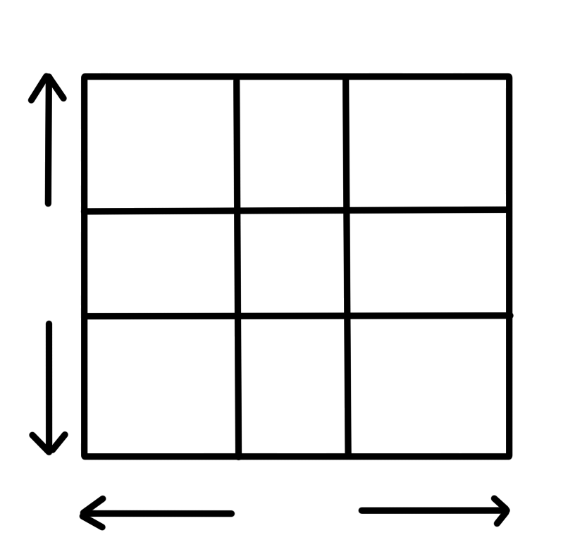
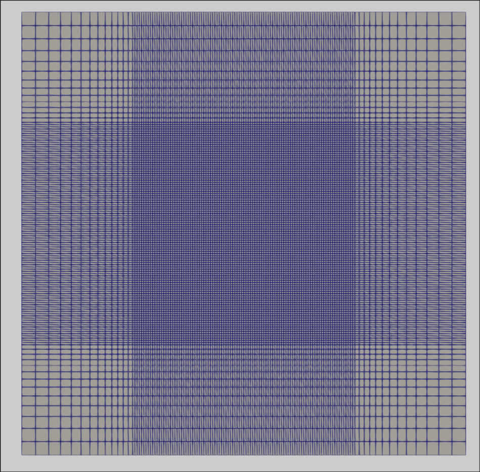

# TP1 - Basique de l'API Salome

## Objectifs

L'objectif dans cette partie sera de mailler cette forme géométrique très simple : 



Cela permet de voir les fondamentaux de l'API de Salome et de vous rendre indépendant 
sur cet API.

## Environnement de travail

Avant de rentrer dans le vif du sujet, vérifions que tout fonctionne de votre côté. 
Tout d'abord il faut inclure les modules nécessaires dans votre fichier python 

```python
import salome

import GEOM 
from salome.geom import geomBuilder

import SMESH 
from salome.smesh import smeshBuilder
```

Dans ces quelques lignes nous importons depuis les modules `geom` et `smesh` deux 
classes `geomBuilder` et `smeshBuilder` qui comme leurs noms l'indiquent permettent 
respectivelent de contruire la géométrie et le maillage.

Ensuite, il faut créer les deux objets en question : 

```python 
geompy = geomBuilder.New()
smesh  = smeshBuilder.New()

```

Enfin, pour vérifier que tout fonctionne bien, contruisons un cube et exportons 
cette géometrie au format .vtk par exemple : 

```python 
pt1 = geompy.MakeVertex(0, 0, 0)
pt2 = geompy.MakeVertex(1, 1, 1)

box = geompy.MakeBoxTwoPnt(pt1, pt2)

geompy.ExportVTK(box, "geometry.vtk")
```

Dans la suite, nous nous référons constamment à la documentation, il y a 
deux pages sur lesquelles vous devez vous appuyer : 

- [La géometrie](https://docs.salome-platform.org/latest/gui/SMESH/modules.html) : vous 
avez ici la documentation qui vous liste par sous catégorie toutes les méthodes pour mailler.
- [Le maillage](https://docs.salome-platform.org/9/gui/GEOM/geompy_doc/group__l1__geomBuilder__purpose.html) : 
vous avez ici la documentation pour réaliser des géomtries complexes. Toujours revenir à ce point de départ 
lorsque vous cherchez qqch. 

Dans la suite pour la navigation au sein de la documentation lorsque vous verrais : 
`HGEOM` et HMESH` cela fera référence aux adresses cités précédement, le `home`. Par exemple, 
l'adresse suivante donne accès aux méthodes pour construire des primitives dans geompy : 

```bash 
HGEOM/Creating geometrical objects/Creating basic Geometric Objects/
```

Les adresses ne sont pas dynamiques volontairement pour que vous puissiez vous repérer 
dans la documentation.

## Géométrie 

### Rectangle

Vous avez plusieurs façons de construire une géométrie sous SALOME, 
vous avez des formes déjà toutes prêtes commes des cubes, des cylindres, ...
vous pouvez trouver cela dans ici : 

```bash 
HGEOM/Creating geometrical objects/Creating 3D Primitives/
```

Ce que je vous propose plutôt ça va être de constuire nous même le rectangle 
sur l'image plus haut. L'intête c'est ce que vous allez voir comment faire 
n'importe quelle forme.

Pour cela rendez-vous ici : 

```bash 
HGEOM/Creating geometrical objects/Creating basic Geometric Objects/
```
Vous pouvez tracer des points, des lignes, les reliez ensemble et créer une surface.
Les méthodes sont les suivantes : 

```python 
    pt1       = geompy.MakeVertex(x, y, z) 
    line      = geompy.MakeLineTwoPnt(pt1, pt2)
    wire      = geompy.MakeWire([line1, line2, ...])
    rectangle = geompy.MakeFace(wire, True)
```

Pour tracer le rectangle vous devez faire attention aux lignes, en effet 
elles ont un sens vous ne pouvez pas relier deux lignes entre elle si elles 
ne forment pas un contour orienté fermé.

Bien évidemment vous pouvez aussi tracer d'autres éléments, je vous laisse 
regarder dans la documentation. 

### Partitions

Précédement, vous avez vu qu'on a découpé notre rectangle en plusieurs sous formes, 
notamment en 9 sous rectangles l'intérêt ici est surtourt pour permetter lors du 
maillage de mailler plus précisment certains endroits comme pare exemple, on veut plus
maille dans le rectangle du milieu.

Pour conserver la forme de votre domaine tout en créeant des sous formes vous 
pouvez faire des partitions. Cela se trouve dans : 

```bash 
HGEOM/Transforming geometrical object/Basic Operations
```

Pour l'utiliser : 

```python 
geometry = geompy.MakePartition([rectangle], [line1, line2, ...])
```

Je vous laisse ici réaliser le découpage effectué sur l'image du haut.

## Groupes

Passons maintenant sur la construction des groupes. Ici nous allons créer des 
groupes sur la géométrie cela signifie que l'on va rassmebler ensmeble des formes 
d'un même type comme par exmple un groupe d'edges ou alors de faces etc. Ces groupes 
seront utiles par la suite pour créer des groupes sur le maillage qui seront utilisés 
poru deéfinir vos conditions aux limites. 

Pour créer un groupe vous pouvez faire appel à la fonction suivante : 

```python 
inlet = geompy.CreateGroup(geometry, geompy.ShapeType['FACE'])
```

qui se trouve ici : 

```bash 
HGEOM/Creating geometrical objects/Working with groups
```

Vous venez de créer un groupe mais pour le moment il ne contient aucune face, 
en effet avec **geompy.ShapeType['FACE']**, vous spécifiez que vous faites 
un groupe de face. Il faut mainteant rajouter ces faces dans ce groupe, 
vous avez pleins de façons de faire, je vous laisse explorer la documentation, 
mais on peut simplement utiliser la méthode suivante : 

```python
geompy.UnionList(inlet, [face1, face2, ...])
```

qui récuperent donc une liste de face. Ils font donc qu'on récupére ces faces. 
Vous avez plusieurs façons de faire cela, notamment regardez dans ces pages de 
la documentation : 

```bash 
HGEOM/Creating geometrical objects/Creating Advanced Geometrical Objects/Acess to subshape by criteria/
HGEOM/Transforming geometrical objetcs/Blocks Operations
```

Dans le premier cas vous pouvez par exemple utilisez la méthode suivante,
**GetShapesOnPlaneWithLocation(...)** dont vous avez le détail d'utilisation :

```python 
pt = geompy.MakeVertex(0, 5, 0.5)
normal = geompy.MakeVectorDXDYDZ(-1, 0, 0)
faces = geompy.GetShapesOnPlaneWithLocation(
    geometry, 
    geompy.ShapeType['FACE'], 
    normal, 
    pt, 
    GEOM.ST_ON
)
```

Détailons un peu cette méthode, ce qu'elle fait ici, c'est de récupérer toutes 
les faces qui se trouvent dans le plan que vous définissez avec `pt` et `normal`. 
Le parametre `GEOM.ST_ON`, permet de préciser que vous saouhiatez tous ce qui se 
trouvent dans le plan, si vous voulez tous ce qui se trouvent en dehors coté 
orinetation normal vous pouvez utilisez `GEOM.ST_OUT`, je vous invite à regarder 
dans la documentation.

Pour la seconde méthode vous pouvez utiliser : 

```python 
pt = geompy.MakeVertex(0, 5, 0.5)
face = geompyGetFaceNearPoint(geometry, pt)
```

Ce qui vous permet de récupérer la face la plus proche du point que vous définisez, 
un peu comme avec un curseur. Bon ici comme on travaille avec des surfaces planes et 
qu'on a fait des partitions vous avez plsuieurs sous-faces sur la face de l'inlet, 
vous aurez donc besoin d'autant de point que de faces (ce qu'on peut automasatiser 
évidemment, pas ebsoin de définir les points à la main, mais ça revient à utiliser la 
précédente méthode avec le plan).

## Maillage

Intéressons nous mainteant au maillage. 

Tout d'abord à l'image de ce qu'on a fait précédemnt pour créer une géoémtrie, il 
faut créer un maillage sur notre géométrie ce qui se fait avec la méthode : 

```python 
mesh = smesh.Mesh(geoemetry)
```

que vous pouvez retrouver dans : 

```bash 
HMESH/Structured documentation/Creating meshes/Constructing meshes/
```

Dans la suite on s'intéresse au maillage structuré. 
Ensuite vous pouvez mailler à plusieurs échelles différentes, un segment par exemple, 
ou sur un surface 2D ou 3D etc.

La façon de faire est la suivante en vous référant à la documentation : 

```bash 
HMESH/Structured documentation/Creating meshes/Defining Algorithms/
```

Vous allez créer un algorithme de maillage appliquer à une forme

```python 
algo = mesh.Segment(edge)     # Algorithme pour découper un segment
algo = mesh.Quadrangle(face)  # Algorithme pour decouper en rectangle
algo = mesh.Hexahedron(solid) # Algorthme pour mailler avec des pavés/cubes
```

Il faut donc récupérer l'objet auquel on souhaite lui appliquer l'algorithme, 
on a déjà vu ça précédemment, regardez du côté de : 

```bash 
HGEOM/Transforming geometrical objetcs/Blocks Operations
```

notamment la méthode : 
```python
pt = geompy.MakeVertex(1, 1, 1)
edge = geompy.GetEdgeNearPoint(geoemetry, pt)
```

Une fois que vous avez défini l'agorithme il faut lui dire comment 
appliquer la découpe c'est pareil je vous laisse regarder de votre côté, 
mais pour réaliser la figure du début, nous allons utiliser : 

```python 
algo.NumberOfSegments(100)          #
algo.GeometricProgression(0.1, 1.1) # progression géométrique
```

Une autre méthode intéressante est : 

```python 
algo.Propagation()
```

qui vous permet de propager votre algorthme aux 

une fois que vous avez fini de dire comment mailler chaque espace de votre domaine, 
vous pouvez alors cacluler ce maillage en faisant : 

```python 
if not mesh.Compute():
    raise Exception("Impossible meshing")
```

Et voilà vous avez toutes les infos pour obtenir ce magnifique maillage : 


