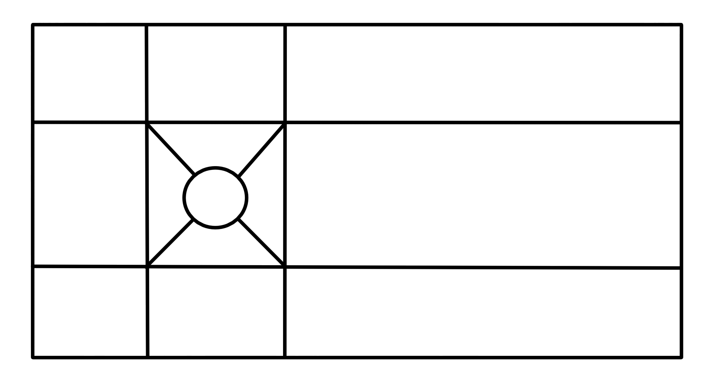

# Maillage du cas test Von Karman
---

## Objectif 
--- 

L'objectif ici est que vous réalisiez le maillage en autonomie du cas test 
qui vous intéresse. Quelques indices vous sont fournis dans la suite.

Quelques conseils avant de démarrer, essayer d'encapsuler ça dans une classe 
ou alors à minima de ne pas laisser de valeurs numériques trainer dans votre 
code, c'est là aussi tout l'intérêt de passer par python, cela vous permet de 
piloter votre géométrie/maillage à l'aide de quelques paramètres caractéristiques. 
Par exemple, vous pourriez tout piloter en ne spécifiant que les apramètres suivants : 

- Dimension du domaine
- Taille du disque
- Distance du disque à l'inlet 
- Taille de maille caractéristique, la plus petite proche au niveau du cercle 
par exemple

Et c'est tout !!

## Géometrie
--- 

Ci dessous vous est proposé une décomposition du domaine géométrique, 
libre à vous de ne pas passer par cette décomposition.



Vous aurez notamment besoin de construire un disk, je vous laisse chercher
dans la documentation le nom de la méthode, regardez du côté de : 

```bash 
HGEOM/Creating geometrical objects/Creating 3D Primitives/
```

Vous aurez également besoin de faire faire une rotation à ce disque pour 
des raisons topologiques. Vous pouvez regarder ça du côté de : 

```bash 
HGEOM/Transforming geometrical object/Transformation Operations/
```

Vous aurez aussi besoin d'une opération booléen pour enlever de la matière à votre 
domaine (enlever le cercle). Regardez du côté de : 

```bash 
HGEOM/Transforming geometrical object/Boolean Operations/
```

## Groupes 
---

Pour ce qui est des groupes vous avez déjà vu l'essentiel des méthodes dans le TP 
précédent.

## Maillage
---

Pour le maillage vous avez également vu l'ensemble des méthodes nécessaires dans 
le TP précédent.

## A vous de jouer 

> N'hésitez pas si vous avez besoin d'aide.
