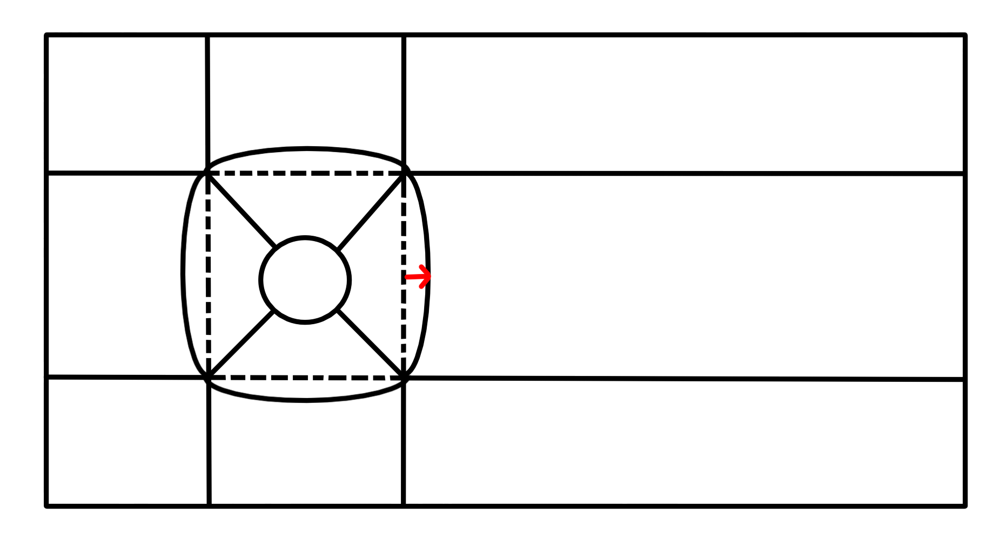

# Optimisation topologique

## Objectifs

L'objectif de ce tp est d'améliorer le maillage que vous avez précédemment obtenu. 
En l'état le maillage actuel comprend des mailles avec uin très mauvais aspect ratio 
par exemple pour ne citer que ce critére de qualité. Nous allons notamment nous 
concentrer dans cette partie à améliorer ce critère. 

De manière identique au TP précédent quelques pistes vous serons fourni, masi vous êtes en 
autonomie sur ce TP.

Deux optimisations vous sont présentés ici l'une porte sur la géométrie qui a un impact
direct sur le maillage et l'autre sur la construction du maillage en lui même.

## Géométrie

Voici la nouvelle décomposition du domaine visé dans ce TP qui permet d'améliorer 
drastiquement la qualité du maillage.



Comme vous pouvez le constater la différence réside dans le fait que le carré central 
comporte des côtés avec une courbure. 

Pour réaliser des arcs je vous invite à regarder du coté de

```bash
HGEOM/Creating geometrical objects/Creating Basic Geometric Objects/Creating Curves
```

Je vous propose une méthode dans la suite, libre à vous de faire selon votre préférence. 
Pour tracer les arcs, j'utilise la méthode : 

```python 
arc = geompy.MakeArc(pt1, pt2, pt3)
```
qui consiste donc à tracer un arc passant par 3 points. 

Je vous propose donc de contrôler la courbure de vos côtés en utilisant en utilisant un
paramètre $r \in [0;1]$ qui est un ratio qui corresponds à un pourcentage de la distance marquée 
en rouge sur l'image précedente, qui est donc la projection du point du milieu de l'arc sur 
le côté d'un carré. L'idée ici est que vous souhaitez faire varier votre côté 
entre une droite et la courbure d'un cercle. Vous pouvez donc exprimer (pythagore) 
cette distance notée $d$ pour un carré de demi-coté $l$

$$ d = r l (\sqrt{2} - 1) $$

L'intérêt de formuler le problème de cette façon est que vous allez pouvoir faire varier 
ce paramètre, i.e la courbure de vos côtés de carrés jusqu'à que ce votre maillage est le 
meilleur aspect ratio de la pire maille. Vous pouvez procéder de deux façons pour ce faire 
qui sont détaillés briévement à la fin de ce TP.

Pour la suite c'est comme ce que vous avez déjà fait.

## Groupe 

Pour les groupes en principe rien ne change.

## Maillage 

Vous l'avez peut être certainement remarqué mais en l'état dans notre zone d'intéret le maillage 
n'est pas de bonne qualité. En effet avec la progression géométrique dans le centre et l'espacement 
du au fait que l'arc du cercle est plus petit on se retrouve avec des mailles étirées ce qui donne un 
très mauvais aspect ratio, vous pouvez d'ailleurs trouvez toutes sortes de fonctions sur la qualité 
du maillage ici : 

```bash
HMESH/Structured documentation/Quality controls and Filtering/
```

L'idée ici pour obtenir un bon aspect ratio qui est défini comme le rapport suivant : 

$$Aspect Ratio = \frac{Longueur de l′arête la plus longue}
                      {Hauteur de l'arête la plus courte}

est d'essayer d'obtenir des rectangles tout simplement. Cela signifie qu'il faut controler 
la progression géométrique en fonction de la taille de maille caractéristique obetnue. La taille 
caractèristique de maille obtenu donne le nb de segment sur le coté du cylindre et du carré courbé.
Il faut donc adpater la progression géoémtrique poru qu'à la fin les mailles soient toujours carrés.
Il suffit donc de calcuelr la taille d'un segment sur le côté courbé du carré et de calibrer votre 
progression géométrique pour qu'elle donne à la fin la même taille sur selon $\arrow{e}_r$ si on se place 
dans un repère cylindirique. L'idée est donc d'obtenir $dr = r d\theta$. Vous pouvez donc définir : 

$$ u_n = u_0 q^n = r d\theta = dr$$ 

## Optimisation de la courbure du carré central

## Et après ? 

Vous avez obtenu un maillage de très bonne qualité !! Mais vous pouvez faire mieux ! 
Vous pouvez regarder du côté de : 

- 

